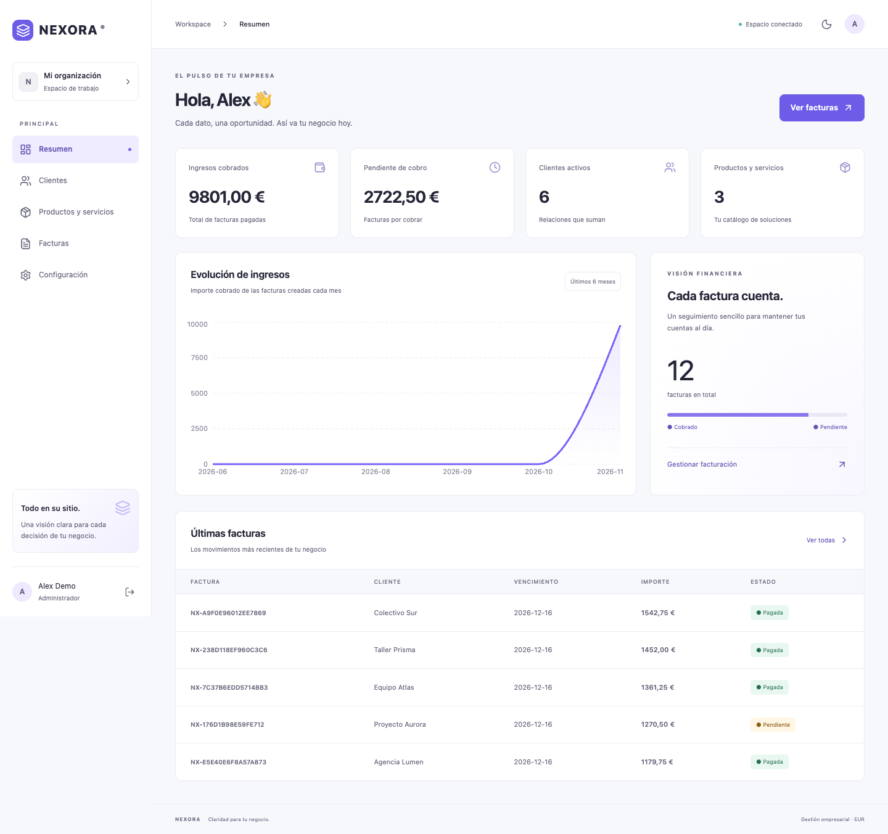
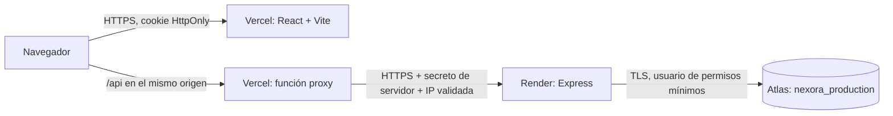
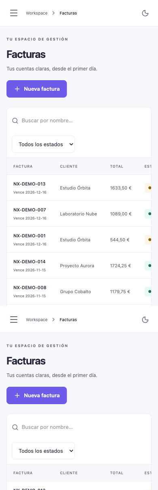

# NEXORA

[](https://github.com/cristoferdiazalvarez/nexora/actions/workflows/ci.yml)

Aplicación Full Stack de gestión empresarial con organizaciones independientes, clientes, catálogo y facturación. Proyecto de portfolio orientado a demostrar flujos completos, seguridad en backend y pruebas reproducibles.

**Demo pública verificada:** https://nexora-eta-steel.vercel.app · [API health](https://nexora-api-y6u5.onrender.com/api/health). Dos flujos E2E aprobados contra producción; [CI aprobada](https://github.com/cristoferdiazalvarez/nexora/actions/runs/43890892205) con 20 pruebas de unidad/integración, lint, build y E2E. Vercel Hobby + Render Free + Atlas M0 independiente, sin facturación activada. [Estado](STATUS.md) · [Despliegue](docs/DEPLOYMENT.md) · [Seguridad](docs/SECURITY.md). Render Free puede necesitar un arranque en frío tras inactividad.



## Qué permite hacer

- Registrar una empresa y su administrador; iniciar sesión, mantenerla al recargar y cerrarla con revocación.
- Administrar clientes, productos/servicios y facturas; buscar, filtrar estados y paginar listas.
- Crear facturas con conceptos múltiples, vencimiento, cantidades, precios en céntimos e impuestos configurables. Backend calcula y valida todos los totales.
- Descargar PDF y marcar facturas como pendientes o pagadas.
- Ver ingresos cobrados, pendientes, clientes, catálogo, últimos movimientos y evolución de seis meses con datos reales de la organización.
- Editar el propio perfil; administradores configuran empresa e impuestos y crean usuarios admin/empleado.
- Trabajar en escritorio y móvil, alternar tema claro/oscuro y recibir notificaciones y errores útiles.

Los empleados tienen lectura de los datos de su empresa y PDF, y pueden editar su propio nombre. El servidor limita cada consulta, modificación y descarga a la organización de la sesión. Los permisos de la interfaz complementan los del backend.

## Tecnologías y arquitectura

React 19, TypeScript, Vite 8, Tailwind CSS 4, React Router, TanStack Query, React Hook Form, Zod, Recharts, Express 5, MongoDB/Mongoose, PDFKit, Vitest, Supertest, Playwright y axe.



El navegador no necesita CORS entre dominios ni cookies de terceros. La función de Vercel conserva las cookies en el origen web y transmite PDF. El secreto del proxy se configura solo en los entornos de servidor de Vercel y Render; nunca usa prefijo `VITE_`. Acceder directamente a Render queda bloqueado salvo `GET /api/health`.

```text
apps/web/           Interfaz React, estilos y cliente HTTP
apps/api/src/       API, modelos, importes, seguridad y seed
api/index.ts        Entrada de función Vercel
scripts/proxy.ts    Proxy con lista de encabezados permitidos
scripts/            Capturas y escáner de publicación
apps/api/src/*.test.ts  Unidad e integración con MongoDB temporal
e2e/                Navegador, accesibilidad y flujos HTTP
.github/workflows/  CI con MongoDB y Chromium
```

## Ejecución local

Requiere Node.js **24 LTS**, npm y MongoDB 8 (local o Docker). No necesita servicios externos ni cuentas de pago.

```sh
npm ci
cp .env.example .env
docker compose up -d
npm run seed
npm run dev
```

Si MongoDB ya está escuchando en el puerto 27017, omite Docker. Web: http://localhost:5173. API: http://127.0.0.1:4000/api/health. Usa `localhost` en el navegador para que coincida con `APP_ORIGIN`. El proxy de Vite conecta con Express.

El seed crea únicamente información ficticia y la cuenta `admin@nexora.example`; genera e imprime una contraseña aleatoria, sin guardarla en el repositorio. Se niega a repetir la demo y no borra bases existentes. También se puede registrar una organización vacía desde `/login`.

En la máquina donde se construyó este proyecto se conservan datos demo en `.local/mongo` y acceso en `.local/demo-access.txt`, excluidos de Git. Su `.env` local usa el puerto **27018**, independiente del puerto estándar del ejemplo. Reinicio de esa instancia desde la raíz:

```sh
mongod --dbpath "$PWD/.local/mongo" --bind_ip 127.0.0.1 --port 27018 --logpath "$PWD/.local/mongo.log"
# En otra terminal:
npm run dev
```

## Comprobaciones

```sh
npm run lint        # ESLint y TypeScript: web, API y funciones/scripts
npm test            # Vitest + Supertest + MongoDB temporal
npm run build       # Compila API y frontend
npm run test:e2e    # Web/API ya arrancadas; Chrome local o Chromium
npm run security:scan  # Revisa archivos del índice Git antes de publicar
npm audit
```

La primera ejecución de MongoDB Memory Server descarga un binario de MongoDB. Se puede usar un binario ya instalado mediante `MONGOMS_SYSTEM_BINARY=/ruta/a/mongod npm test`.

Para comprobar el build local: compila, arranca la API con `npm run start -w apps/api` y la web con `npm run preview -w apps/web`. `CHROME_PATH` permite elegir el navegador; en macOS se detecta Chrome y en Linux se usa Chromium de Playwright. `E2E_BASE_URL` permite ejecutar los mismos flujos contra una demo HTTPS autorizada. **Esas pruebas crean organizaciones y datos ficticios**; no apuntes a una aplicación con información real.

GitHub Actions instala dependencias desde lockfile, escanea publicación, ejecuta lint/TypeScript, unidad/integración, build y E2E con MongoDB aislado y Chromium. La prueba de navegador revisa persistencia, login/logout, errores JS/HTTP 5xx, temas, móvil y contraste con axe. Otro flujo verifica CRUD, filtros, páginas, PDF, roles y aislamiento con dos empresas. axe apoya la revisión básica, sin certificar cumplimiento completo de WCAG.

## Rutas

Web: `/login`, `/`, `/clients`, `/products`, `/invoices`, `/settings`.

| API, prefijo `/api`                              | Métodos           | Acceso                                            |
| ------------------------------------------------ | ----------------- | ------------------------------------------------- |
| `/health`                                        | GET               | Público, 200 si MongoDB está conectado; 503 si no |
| `/auth/register`, `/auth/login`                  | POST              | Público en el origen web, con rate limit          |
| `/auth/logout`                                   | POST              | Sesión válida                                     |
| `/me`                                            | GET, PATCH        | Propio usuario                                    |
| `/settings`                                      | GET / PATCH       | Miembro / admin                                   |
| `/users`                                         | GET, POST         | Admin de su organización                          |
| `/clients`, `/products`, `/invoices`             | GET / POST        | Miembro / admin                                   |
| `/clients/:id`, `/products/:id`, `/invoices/:id` | GET / PUT, DELETE | Miembro / admin                                   |
| `/invoices/:id/pdf`                              | GET               | Miembro de la organización                        |
| `/dashboard`                                     | GET               | Miembro de la organización                        |

Listas: `?q=texto&page=1`, diez filas por página. Facturas: `&status=pendiente` o `pagada`. Identificadores ajenos responden 404; el empleado que intenta escribir recibe 403. Clientes con facturas no se pueden borrar.

## Decisiones de seguridad y datos

- bcrypt con coste 12, longitud mínima 12 caracteres y máximo 72 bytes UTF-8; comparación también para cuentas inexistentes.
- Sesiones aleatorias de 256 bits, hash SHA-256 en MongoDB, TTL y comprobación explícita de caducidad de siete días. Producción: cookie `__Host-nexora`, HttpOnly, Secure, SameSite=Lax, sin Domain.
- Mutaciones de producción con origen exacto, JSON y proxy autenticado; no se permite CORS ni se confía globalmente en `X-Forwarded-For`.
- Rate limit por IP procedente del proxy autenticado, agrupando IPv6 para evitar rotación trivial. Se usa memoria para la única instancia gratuita; reinicios reinician los contadores.
- Zod en frontend/backend, campos permitidos explícitos, búsquedas literales, consultas limitadas por organización, errores JSON sin cuerpo ni secretos, Helmet y CSP en Vercel.
- Importes en céntimos; impuestos en puntos básicos (`2100 = 21%`), cálculo intermedio con BigInt y redondeo sobre la base completa. Cantidades enteras y un máximo de 100 conceptos por factura. Los PDF guardan instantáneas de emisor y cliente.
- Dashboard agrega en MongoDB y solo trae cinco facturas recientes. Gráfico cargado bajo demanda y movimiento reducido respetado.

## Capturas

Son imágenes reales del build local con información ficticia; no prueban un despliegue público. El [manifiesto](docs/screenshots/manifest.json) registra hashes y procedencia. `npm run screenshots` las reproduce con credenciales suministradas solo por entorno o desde el archivo demo privado local.

[Modo oscuro](docs/screenshots/dashboard-dark.png) · [Facturas escritorio](docs/screenshots/invoices-desktop.png)

<details><summary>Facturas en móvil</summary>



</details>

## Despliegue y límites

[Plan exacto de publicación y variables](docs/DEPLOYMENT.md). Despliegue completado mediante OAuth de las CLI oficiales. Las pruebas reales HTTPS aprobaron antes de preparar la actualización del portfolio. Los despliegues son explícitos; un push no sustituye la promoción ni la verificación pública.

Este MVP es una demo de portfolio: no incluye recuperación de contraseña, verificación de correo, MFA, auditoría, eliminación de miembros, cobros online, conciliación, abonos ni certificación fiscal. La numeración de factura es única y aleatoria, no secuencial fiscal. Editar facturas toma datos actuales del cliente/emisor. El catálogo y las líneas de factura son independientes. El alta compensa errores de creación de usuario eliminando la organización; un cierre abrupto puede dejar una organización huérfana y aún no se usan transacciones. [Riesgos y medidas](docs/SECURITY.md).
